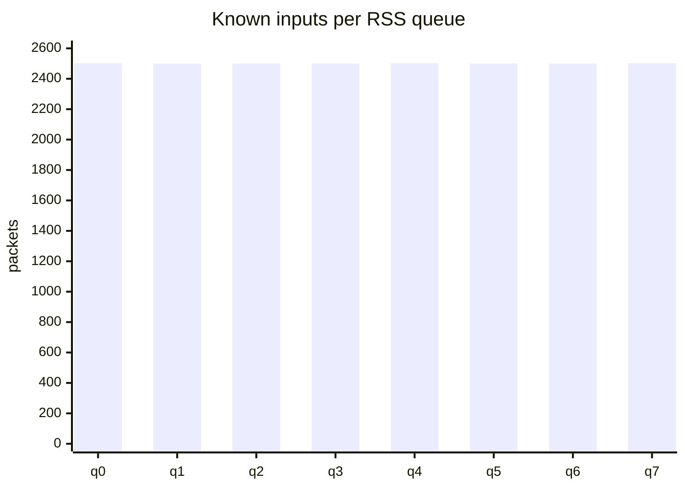

# Milestone 3 experiment report

Date: 2026-10-27 (Asia/Taipei)  
Result: **PASS for file-configured packet fan-out**

This result does not claim reliable multicast RC completion. It verifies the
Node B packet-replication scope; receiver-QP observations remain separate.

## System under test

- Node A DPU: sender SF `enp3s0f0s0` through hardware-offloaded OVS to `p0`;
  replicas return on `p1`.
- Node B DPU: DOCA 3.5.0098, DPDK 26.03.0.5, PCI `03:00.0`/`03:00.1`
  mapped to DPDK ports 2/3.
- Processing: one IPv6 UDP/4791 DOCA Flow RSS path, eight Arm workers, and one
  DOCA ETH TX context per worker and direction.
- Immutable group: `(2001:db8::100, QPN 9000)` to two members:
  `02:7e:6d:fd:79:7c, 2001:db8::1, QPN 101` and
  `02:7e:6d:fd:79:01, 2001:db8::2, QPN 102`.
- Source revision: `4d2eddc2975df6dc4969d5a6814d4e3bc944dc09`, plus the
  experiment-driver/readiness changes recorded in the working tree.

The target image's six Meson tests and the local 10 Python plus 6 packet/config
tests passed immediately before the experiment.

## Recorded workload

The primary run used tag `m3-20261027T154250Z`:

| Parameter | Value |
| --- | ---: |
| Timed known-group inputs | 20,000 |
| Preliminary known inputs in the same clean Node B session | 8 |
| UDP source flows | 64 |
| Application payload | 512 bytes |
| IPv6 Ethernet frame, excluding FCS | 590 bytes |
| Sender interval | 0 seconds (Python/raw-socket limited) |
| Timed send window | 3.948194873 seconds |
| Unknown-group inputs | 256 |

The timed load achieved 5,065.606 input packets/s. Since both replicas
completed without loss, this corresponds to 10,131.212 completed replica
packets/s, 41.497 Mbit/s of replicated application-payload goodput, and
47.819 Mbit/s over the 590-byte Ethernet frames. These are achieved rates for
this Python generator, not a maximum-capacity or 100-Gbit/s claim. Completion
timestamps were not sampled independently, so the rate denominator is the
sender's recorded injection window.

A post-load `docker stats` snapshot reported 801.39% CPU, 106.9 MiB memory and
15 processes. The eight worker loops poll continuously, so this is a
steady-state busy-poll snapshot rather than an isolated per-packet CPU cost.

## Results

Node B shut down cleanly with exit status 0. The controlled totals were:

| Counter | Expected | Observed |
| --- | ---: | ---: |
| Known inputs | 20,008 | 20,008 |
| Member 0 submitted/completed | 20,008 / 20,008 | 20,008 / 20,008 |
| Member 1 submitted/completed | 20,008 / 20,008 | 20,008 / 20,008 |
| Total replicas completed | 40,016 | 40,016 |
| Unknown groups dropped | 256 | 256 |
| Member/TX errors | 0 | 0 |
| Replication drops | 0 | 0 |
| Pending buffers after drain | 0 | 0 |

All 64 controlled flows exercised all eight queues. Known inputs were balanced
within two packets of 2,500 per queue, and every queue received exactly 32
unknown-group packets.



The DOCA Flow forward counter observed 20,320 packets. Besides the controlled
20,008 known and 256 unknown inputs, Node B rejected 49 malformed and 7
unsupported ambient UDP/4791 packets. Those background packets are reported
separately and did not affect member submissions. The reverse Flow counter saw
66 ambient packets, which were forwarded unchanged.

Raw per-queue data is in
[`milestone-3-artifacts/queue-results.csv`](milestone-3-artifacts/queue-results.csv).

## Correctness and pressure evidence

- The independent IPv6 wire oracle previously sent 64 controlled inputs and
  captured exactly 128 byte-exact member outputs. Destination MAC/IP/QPN,
  mandatory IPv6 UDP checksum and full ICRC all agreed independently; each of
  the eight queues handled eight inputs.
- Current OVS hardware offload bypasses the Node A `p1` AF_PACKET observation
  point. Diagnostic attempts saw 17/40,000, 16/40,000 and 5/16 expected frames
  even though Node B completed every replica. Therefore physical-port capture
  was not used as the sustained-run loss counter. This is an observation-plane
  limitation, not silently treated as success.
- The target test suite exercises a full two-slot pool, per-member drops,
  submission failure, completion error, reverse completion order, stale
  completion rejection and independent buffer contents. The ownership stress
  loop performs 20,000 submissions per queue ID (160,000 across eight queue
  IDs), alternating 10,000 successes and 10,000 completion errors per queue,
  and drains to zero without aliasing or leaks.
- The live run added 40,016 successful replica completions with zero pool-full,
  submit, completion or drain failures.

## Configuration rejection

`reports/milestone-3-artifacts/invalid-groups.json` contains match QPN
`16777216`, one above the 24-bit maximum. Running the actual `node_b` image
entrypoint with that file, without privileged hardware access, produced:

```text
Invalid group configuration near byte 113 (schema, duplicate or limit)
exit_code=2
```

The error occurred before EAL output or device initialization, demonstrating
that the complete file is validated before workers start.

## Acceptance assessment

Milestone 3's packet-fan-out criteria pass: the immutable file is validated at
startup; two independently owned member packets are generated; the earlier
wire oracle verifies the rewritten bytes/checksums; the recorded eight-worker
load completes exactly two replicas per known input with no TX loss; unknown
groups are counted and dropped; invalid configuration prevents startup; and
pressure/error paths preserve ownership and drain correctly.

The measured rate is generator-limited and is not a line-rate benchmark.
Hardware-offloaded OVS also prevents AF_PACKET from independently capturing
every sustained-run replica. A future capacity study should use an external
hardware traffic generator/capture port and record loss versus offered load.
